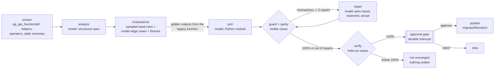

# erp-migration-agent

An agentic workflow, built with LangGraph, that ports real legacy business rules out of a 20-year-old
ERP into modern, tested Python, and proves each port matches the original with characterization
tests where **the legacy code is the oracle**.

This is a local demo against [iDempiere](https://www.idempiere.org/) 12 (Compiere/ADempiere lineage)
running in Docker with a fictional brand's synthetic data (see `../erp-sandbox`). The model is Claude
(`claude-opus-5-5`, medium effort), reached through the locally logged-in Claude Code CLI by
`erp_sandbox.llm.ClaudeCodeClient`; a production build would put the Anthropic SDK behind the same
`complete_json` interface.

The patterns here mirror production work I've done; that code is proprietary and not included.

## What it shows

| Posting asks for | Where it is here |
|---|---|
| "Treat 20-year-old legacy systems as puzzles for AI-driven modernization" | The agent reads PL/pgSQL from iDempiere's `adempiere` schema, follows every helper and operator it calls, and ports three functions of rising difficulty. The puzzles are real: legacy `adddays` adds `86400 * n` seconds, so due dates drift an hour across daylight-saving changes, and the port must reproduce that bug for bug. |
| "Deterministic mindset: 100% reliability with automated validation" | A written [metric contract](docs/metric-contract.md): decimal-exact parity (`2.20` ≠ `2.2`, no negative zero), explicit NULL rules, a held-out set the model never sees, and a 100% held-out pass bar. Generated code passes an AST allowlist before it runs, in a limited subprocess. |
| Agentic workflows (LangGraph) | A `StateGraph` with a bounded repair loop and a durable human approval gate (`interrupt` + SQLite checkpointer). |
| Evals and guardrails | `migration-agent eval` replays every target from committed cassettes and reports parity, repairs, case counts and model usage. |
| Python, SQL | Python 3.12 ports with `decimal`/`datetime` semantics matched to PostgreSQL; catalog SQL for extraction, deterministic sampling SQL, rolled-back fixture inserts. MCP and RAG are out of scope here (the sibling `erp-schema-agent` covers MCP). |

## How it works



The model **proposes**: the spec, edge cases, and module source. Deterministic code **decides**:
the oracle records golden outputs, the guard and runner execute, parity compares, and an approver
decides at the gate: a named person, or an agent or the auto-approve flag, which every record
labels as non-human.

- **Extract** (deterministic): the function source, every schema function it calls (transitively,
  including functions behind custom operators such as `timestamptz + numeric`), and the columns the
  source names in each table it reads.
- **Characterize**: up to 24 cases sampled deterministically from seeded rows, plus up to 20 edge
  cases the model proposes. An edge case may add **fixture rows** (a fixed-due-date payment term, a
  2026 holiday) that the seed lacks. They are inserted in a transaction that always rolls back.
  PostgreSQL normalizes every argument, then the legacy function produces the golden output.
- **Split**: every third case per source (by `sha256` of the case id) is held out.
- **Port and repair**: the port reads tables only through an explicit `data.select(...)` interface
  over a snapshot of exactly the rows and columns the oracle saw, plus `data.session_tz`.
- **Approval**: `migrate` stops at the gate; `approve <run-id>` (another process, later) resumes it
  and writes `migrated/<function>/`: the module, `golden_cases.json`, `snapshot.json`, a generated
  pytest file, a dated parity report, `approval.json` (timestamp, approver, parity summary, hashes)
  and the audit log of every model proposal and verdict.

### Why the legacy function is the oracle

Nobody has a complete written spec for a 20-year-old business rule. The running code *is* the spec,
including its quirks, and downstream reports, reconciliations and customers already depend on them.
Asking PostgreSQL what the function returns is the only source of truth that cannot drift from
production behaviour. A modern rewrite that "fixes" the daylight-saving drift in `paymenttermduedate`
would silently move due dates; parity against the oracle makes that change a visible, deliberate decision.

### Why there is a held-out set

The repair loop shows the model every visible mismatch, so passing the visible set can mean the
model fitted those cases instead of the rule. Held-out cases never appear in a port or repair
prompt, and no prompt ever contains their golden outputs; they only feed the final check. (The model
did propose the inputs of held-out *edge* cases, before any output was recorded.) A port that passes
them generalized at least that far. It is evidence, not a proof of equivalence.

## Targets

| Function | Difficulty | Why |
|---|---|---|
| `currencyround` | warm-up | One table read, NULL pass-through, costing flag, PostgreSQL rounding (half away from zero, fixed scale) |
| `paymenttermduedate` | branching | Fixed-day versus net-days terms, month cutoff, `ADD_MONTHS`, day truncation and 86400-second days in `America/Los_Angeles` |
| `paymenttermdiscount` | multi-table | Payment terms, currencies, client accounting schemas and holidays (via `nextbusinessday`); discount windows, grace days, rounding, NULL precision |

## Run it

Needs the sandbox stack (`cd ../erp-sandbox && uv run erp-sandbox status`) and `uv`.

```sh
uv sync
uv run migration-agent demo                     # warm-up end to end, offline from cassettes, AUTO-APPROVED
uv run migration-agent migrate paymenttermduedate   # prints each stage, stops at the approval gate
uv run migration-agent approve <run-id> --by <name> # --by is required; or: reject <run-id> --note "..."
uv run migration-agent eval                      # replay all targets; writes evals/reports/
uv run migration-agent eval --record             # record missing cassettes with live model calls
uv run pytest
```

`demo` runs `currencyround` with `ERP_LLM_MODE=replay` and the auto-approve flag; the console line,
the parity report and the `label`/`approver` fields of every decision record say
"AUTO-APPROVED (flag, not a human review)". It writes to `runs/demo/migrated/` so
the committed evidence in `migrated/` stays untouched. A live run is `migrate` with the default
`ERP_LLM_MODE=record`: cassettes are reused when the prompt matches and recorded when not.

The database is required even offline: it is the oracle.

## Results

Measured on 2026-11-19 with `claude-opus-5-5` at **medium** effort, replayed from the committed
cassettes (`uv run migration-agent eval`, full report in
[evals/reports/eval-report.md](evals/reports/eval-report.md)):

| Function | Difficulty | Held-out parity | Visible parity | Repairs | Cases (sampled + edge) | Model calls | Recorded cost estimate |
|---|---|---|---|---|---|---|---|
| `currencyround` | warm-up | 14/14 (100%) | 28/28 | 0 | 42 (24 + 18) | 3 | $0.30 |
| `paymenttermduedate` | branching | 13/13 (100%) | 28/28 | 0 | 41 (24 + 17) | 3 | $0.53 |
| `paymenttermdiscount` | multi-table | 14/14 (100%) | 29/29 | 0 | 43 (24 + 19) | 3 | $0.76 |

All three converged on the first port. What that does and does not say:

- **The cases were hard.** The model's edge cases included net-days terms crossing both
  daylight-saving changes, fixed-day terms whose day 31 spills from February into March, fractional
  grace days that cross midnight, a Friday holiday followed by a weekend, `currency_id = 0` falling
  back to the client's accounting-schema currency, and an unknown currency returning NULL. The
  accepted ports reproduce the legacy drift (for example a due date of `2026-03-22 01:00 PDT` for a
  document dated `2026-02-20` on 30-day terms). 6 proposals were rejected because their fixture rows
  broke a table constraint.
- **The repair loop did not fire in these recorded runs.** It is exercised by the scripted workflow
  tests (a port that ignores the costing flag is repaired; one that never converges stops after 3
  repairs and writes nothing). A development run before these recordings did trigger it, and
  exposed a bug in the parity rules rather than the port (recorded in AGENTS.md).
- **Per-function calls:** analyze, edge cases, port. Recorded model time 423 s in total; costs are
  Claude Code's client-side estimates stored in the cassettes.

The three approved ports live in [`migrated/`](migrated/). They went through the gate with
`approve --agent`: every record is labelled "APPROVED BY AN AGENT (owner review pending)", because
the repository owner has not reviewed them yet. Their generated tests run
the port offline against the pinned golden outputs and re-check the legacy function when the database
is up (`uv run pytest`: 285 passed with the stack up; 150 passed and 135 skipped with it down).

## Guardrails

- **Generated code** passes an AST allowlist before it runs: imports only from `decimal`, `datetime`,
  `math`, `dataclasses`, `typing`, `enum`, `calendar`, and only their public, non-module members; no
  `exec`/`eval`/`open`/`getattr`/`type`, dunder names, dunder-looking strings, clock reads or
  `global`. It then runs in a separate Python process with an empty environment, a timeout, CPU,
  memory and file-size limits, restricted builtins and proxy modules that expose the same member
  allowlist. **This is not a full sandbox**: the process runs as the same user and can read files a
  Python process can reach. The threat model is a well-meaning model making a mistake.
- **The oracle is read-only in effect**: sampling runs in `READ ONLY` transactions; fixture rows
  are inserted in transactions that always roll back; the legacy call itself always runs read-only.
- **Parity is strict** (see the contract): exact text form for numeric, identity type checks, only
  `None` for NULL, and a port that never ran never "matches" a legacy error.
- **Cassettes** make demos and evals replay byte-for-byte; prompts contain no run ids or timestamps.
- **Nothing is written to `migrated/` without an approval record.**

## Deterministic versus model-driven

| Deterministic | Model (Claude via `complete_json`, schema-validated) |
|---|---|
| Extraction, sampling, fixture insertion, golden outputs, split, guard, runner, parity, approval gate, artifacts, reports | Spec (analyze), edge-case proposals, module source (port), repairs |

## Limitations

- Three PL/pgSQL functions, one database, one pinned session time zone. Parity covers recorded cases only.
- Fixture rows skip deferred foreign-key checks because they never commit.
- The guard and runner are defence in depth, not isolation.
- Cost figures are Claude Code's client-side estimates recorded with each cassette.

## At enterprise scale (future work)

The same loop applies where the legacy rule lives in Java callouts (iDempiere's `org.compiere.model`
callouts and model validators) or COBOL batch programs: run the original as the oracle behind a
harness (a JVM test harness or a COBOL runtime), sample inputs from production-shaped data, keep a
held-out set, and gate each port on parity plus a human approval. The hard parts change: capturing
side effects and database writes as outputs, and environment state such as dates, locale and
configuration. That is not built here.

## Repository map

- `docs/metric-contract.md`: parity, case rules, pass bar
- `src/erp_migration_agent/`: `graph.py` (workflow), `oracle.py`, `extract.py`, `characterize.py`,
  `guard.py`, `runner.py`, `parity.py`, `pgtypes.py`, `prompts.py`, `artifacts.py`, `evals.py`, `cli.py`
- `cassettes/`: recorded model responses
- `migrated/<function>/`: approved ports with their characterization tests and evidence
- `evals/reports/`: eval report (JSON, Markdown) and per-function audit logs
