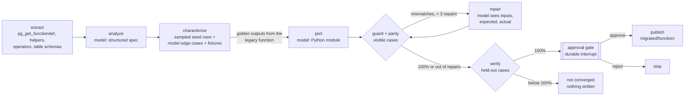

# erp-migration-agent

This repository contains an agentic workflow that uses LangGraph. The workflow makes ports of legacy
business rules from an ERP that has 20 years of history. Each port is new Python code that has tests.
Characterization tests show that each port gives the same results as the legacy function. In these
tests, **the legacy code is the oracle**.

This repository is a local demo. It uses [iDempiere](https://www.idempiere.org/) 12 (which comes from
Compiere/ADempiere). iDempiere operates in Docker with synthetic data for a fictional brand (refer
to `../erp-sandbox`). The model is Claude (`claude-opus-5-5`, medium effort).
`erp_sandbox.llm.ClaudeCodeClient` connects to the model through the Claude Code CLI, which has a
local login. In a production build, the Anthropic SDK is behind the same `complete_json`
interface.

The patterns here come from production work that I did. That code is proprietary, and this repository does not include it.

## Items that it shows

| Item from the job posting | Location in this repository |
|---|---|
| "Treat 20-year-old legacy systems as puzzles for AI-driven modernization" | The agent reads PL/pgSQL from the `adempiere` schema of iDempiere. It follows all helper functions and operators that the code calls. It makes ports of three functions, and each function is less easy than the function before it. These problems are in the legacy code: legacy `adddays` adds `86400 * n` seconds. Thus, due dates move by an hour when daylight saving time starts or stops. The port must do the same, bug for bug. |
| "Deterministic mindset: 100% reliability with automated validation" | A [metric contract](docs/metric-contract.md) document gives the rules. Parity must be correct to the last decimal digit (`2.20` ≠ `2.2`, no negative zero). The NULL rules are specified. The model does not see the held-out set at any time, and the pass bar for the held-out set is 100%. Generated code passes an AST allowlist before it runs. Then it runs in a subprocess that has limits. |
| Agentic workflows (LangGraph) | A `StateGraph` with a repair loop that has a limit, and an approval gate for a person. The approval gate continues after the process stops (`interrupt` + SQLite checkpointer). |
| Evals and guardrails | `migration-agent eval` replays all target functions from committed cassettes. It gives a report of the parity, the repairs, the number of test cases and how much it used the model. |
| Python, SQL | Python 3.12 ports, with `decimal`/`datetime` semantics that agree with PostgreSQL. Catalog SQL for extraction, deterministic SQL that gets samples, and fixture inserts that roll back. This repository does not include MCP and RAG (the related `erp-schema-agent` repository shows MCP). |

## How it operates



The model **recommends** the spec, the edge cases and the module source. Deterministic code **makes
the decisions**. The oracle records the golden outputs, the guard and the runner operate, and
the parity check compares the results. At the gate, an approver makes the decision. The approver is
a person with a name, an agent, or the auto-approve flag. All records identify an agent or the flag
as not a person.

- **Extract** (deterministic): this step gets the function source and all schema functions that the
  function calls. It also gets, at all levels, the schema functions that those functions call. These include
  functions behind custom operators, for example `timestamptz + numeric`. The step also gets the
  columns that the source names in each table that the source reads.
- **Characterize**: a deterministic sample of up to 24 test cases from the seed rows, and up to 20
  edge cases that the model recommends. An edge case can add **fixture rows** that the seed does not
  have (for example, a fixed-due-date payment term or a 2026 holiday). The workflow puts these rows in
  a transaction that always rolls back. PostgreSQL normalizes all arguments, and then the legacy
  function gives the golden output.
- **Split**: for each source, the workflow puts one test case in three into the held-out set (by
  `sha256` of the case id).
- **Port and repair**: the port reads tables only through a specified `data.select(...)` interface.
  This interface operates on a snapshot that contains all the rows and columns that the oracle saw,
  and only those. The port can also read `data.session_tz`.
- **Approval**: `migrate` stops at the gate. Then, `approve <run-id>` continues the run in a different
  process at a subsequent time. It writes these items to `migrated/<function>/`: the module,
  `golden_cases.json`, `snapshot.json`, a generated pytest file and a parity report with a date. It
  also writes `approval.json` (timestamp, approver, parity summary, hashes) and the audit log, which
  records each output from the model and each decision.

### Decision: the legacy function is the oracle

No person has a full spec document for a business rule that has 20 years of history. The code that
operates at this time *is* the spec, and this includes its unusual results. Downstream reports,
reconciliations and customers use these results at this time. The result that PostgreSQL
gives for the function is the only source that cannot become different from the results
in production. If a new version of `paymenttermduedate` "repairs" the daylight saving time drift, it
moves due dates and gives no indication of this change. Parity against the oracle shows that change
clearly, and thus the change becomes a decision that a person must make.

### Decision: a held-out set

The repair loop shows the model all mismatches in the visible cases. Thus, a port can pass the
visible set because the model made it agree with those cases, and not with the rule. Held-out cases
are not in a port prompt or a repair prompt at any time, and no prompt contains their golden outputs
at any time. Only the last check uses them (but the model recommended the inputs of held-out *edge*
cases before the oracle recorded the outputs). If a port passes them, the port is correct, at a
minimum, for these cases that the model did not see. This is an indication, not a proof of
equivalence.

## Targets

| Function | Difficulty | Cause |
|---|---|---|
| `currencyround` | warm-up | Reads one table, gives NULL for a NULL input, uses a costing flag, and uses PostgreSQL rounding (half away from zero, fixed scale) |
| `paymenttermduedate` | branching | Fixed-day terms and net-days terms, a month cutoff, `ADD_MONTHS`, day truncation, and 86400-second days in `America/Los_Angeles` |
| `paymenttermdiscount` | multi-table | Payment terms, currencies, client accounting schemas and holidays (through `nextbusinessday`). Discount windows, grace days, rounding, NULL precision |

## Run it

Make sure that you have the sandbox stack (`cd ../erp-sandbox && uv run erp-sandbox status`) and `uv`.

```sh
uv sync
uv run migration-agent demo                     # warm-up end to end, offline from cassettes, AUTO-APPROVED
uv run migration-agent migrate paymenttermduedate   # prints each stage, stops at the approval gate
uv run migration-agent approve <run-id> --by <name> # --by is required; or: reject <run-id> --note "..."
uv run migration-agent eval                      # replay all targets; writes evals/reports/
uv run migration-agent eval --record             # record missing cassettes with live model calls
uv run pytest
```

`demo` runs `currencyround` with `ERP_LLM_MODE=replay` and the auto-approve flag. The console line,
the parity report and the `label`/`approver` fields of all decision records show
"AUTO-APPROVED (flag, not a human review)". The demo writes to `runs/demo/migrated/`, and thus the
committed evidence in `migrated/` does not change. A live run is `migrate` with the default
`ERP_LLM_MODE=record`. If the prompt agrees with a cassette, the run uses that cassette again. If
not, the run records a new cassette.

The database is necessary also for an offline run, because the database is the oracle.

## Results

The eval measured these results on 2026-11-19 with `claude-opus-5-5` at **medium** effort. It
replayed the committed cassettes (`uv run migration-agent eval`, full report in
[evals/reports/eval-report.md](evals/reports/eval-report.md)):

| Function | Difficulty | Held-out parity | Visible parity | Repairs | Test cases (sample + edge) | Model calls | Recorded cost estimate |
|---|---|---|---|---|---|---|---|
| `currencyround` | warm-up | 14/14 (100%) | 28/28 | 0 | 42 (24 + 18) | 3 | $0.30 |
| `paymenttermduedate` | branching | 13/13 (100%) | 28/28 | 0 | 41 (24 + 17) | 3 | $0.53 |
| `paymenttermdiscount` | multi-table | 14/14 (100%) | 29/29 | 0 | 43 (24 + 19) | 3 | $0.76 |

All three functions converged with the first port. These items give more information about that
result and its limits:

- **The test cases were not easy.** Model edge cases included net-days terms across the two daylight
  saving time changes, and fixed-day terms where day 31 moves from February into March. They also
  included fractional grace days that go across midnight, and a Friday holiday before a weekend.
  Other edge cases were `currency_id = 0`, which uses the accounting-schema currency of the client
  as an alternative, and an unknown currency, which gives NULL. The accepted ports show the
  same legacy drift (for example, a due date of `2026-03-22 01:00 PDT` for a document with the date
  `2026-02-20` on 30-day terms). The workflow rejected 6 recommended edge cases, because their fixture
  rows did not obey a table constraint.
- **The repair loop did not start in these recorded runs.** The scripted workflow tests use the loop.
  In one test, the workflow repairs a port that ignores the costing flag. In a different test, a port
  does not converge at any time, and the loop stops after 3 repairs and writes no output. A
  development run before these recorded runs started the loop. That run found a bug in the parity
  rules, not in the port (AGENTS.md records this).
- **Calls for each function:** analyze, edge cases, port. The total recorded model time is 423 s. The
  costs are client-side estimates from Claude Code, which the cassettes keep.

The three approved ports are in [`migrated/`](migrated/). They went through the gate with
`approve --agent`. All records have the label "APPROVED BY AN AGENT (owner review pending)", because
at this time, the repository owner did not examine them. Their generated tests run the port offline
and compare it with the pinned golden outputs. When the database operates, the tests also examine
the legacy function again (`uv run pytest`: 285 passed when the stack is on, and 150 passed and 135
skipped when the stack is off).

## Guardrails

- **Generated code** passes an AST allowlist before it runs. The allowlist accepts imports only from
  `decimal`, `datetime`, `math`, `dataclasses`, `typing`, `enum` and `calendar`, and only their public
  members that are not modules. It rejects `exec`/`eval`/`open`/`getattr`/`type`, dunder names,
  strings that have the shape of dunder names, reads of the clock, and `global`. Then the code runs in
  a different Python process. This process has an empty environment, a timeout, limits for CPU,
  memory and file size, restricted builtins and proxy modules with the same member allowlist.

  **This is not a full sandbox**: the process runs as the same user and can read the files that a Python
  process can get to. The threat model is a model that makes an error but does not try to cause damage.
- **The oracle is read-only in effect**: the sample queries run in `READ ONLY` transactions. The
  workflow puts fixture rows in transactions that always roll back. The call to the legacy function
  also always runs read-only.
- **Parity accepts no differences** (refer to the contract). The text of numeric values must be the
  same, and the types must be the same (identity check). Only `None` agrees with NULL. If a port did
  not run, it does not "match" a legacy error at any time.
- **Cassettes** make demos and evals replay byte-for-byte. Prompts do not contain run ids or
  timestamps.
- **The workflow does not write to `migrated/` without an approval record.**

## Deterministic and model-driven

| Deterministic | Model (Claude through `complete_json`, schema-validated) |
|---|---|
| Extraction, samples, fixture rows, golden outputs, split, guard, runner, parity, approval gate, artifacts, reports | Spec (analyze), edge cases that the model recommends, module source (port), repairs |

## Limits

- Three PL/pgSQL functions, one database and one pinned session time zone. Parity applies only to
  recorded test cases.
- The deferred foreign-key checks do not apply to fixture rows, because the fixture rows do not
  commit at any time.
- The guard and the runner are defence in depth. They do not isolate the code.
- Cost values are the client-side estimates from Claude Code that each cassette records.

## For enterprise systems (subsequent work)

The same loop applies when the legacy rule is in Java callouts (the `org.compiere.model` callouts and
model validators of iDempiere) or in COBOL batch programs. Run the legacy code as the oracle behind a
harness (a JVM test harness or a COBOL runtime). Get sample inputs from data that has the same shape
as production data, and keep a held-out set. Each port must have parity and the approval of a person
before it goes through the gate. Different parts are not easy: to record side effects and database
writes as outputs, and to record environment conditions, for example dates, locale and
configuration. This repository does not include that work.

## Repository map

- `docs/metric-contract.md`: parity, test case rules, pass bar
- `src/erp_migration_agent/`: `graph.py` (workflow), `oracle.py`, `extract.py`, `characterize.py`,
  `guard.py`, `runner.py`, `parity.py`, `pgtypes.py`, `prompts.py`, `artifacts.py`, `evals.py`, `cli.py`
- `cassettes/`: recorded model responses
- `migrated/<function>/`: approved ports, with their characterization tests and evidence
- `evals/reports/`: eval report (JSON, Markdown) and audit logs for each function
