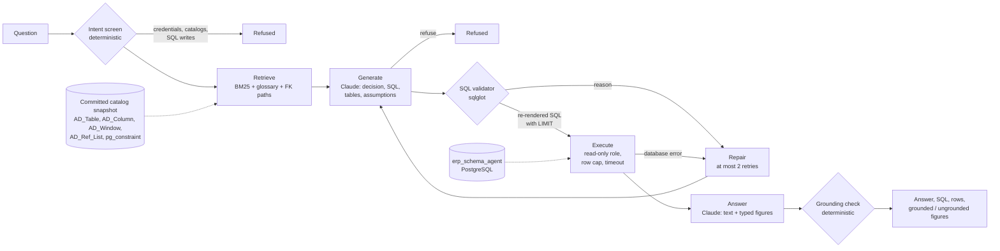

# erp-schema-agent

A LangGraph agent that answers business questions in plain English over a real, 20-year-old
ERP schema: iDempiere 12 (the Compiere/ADempiere lineage), with about 1,000 tables and views
named like `C_BPartner`, `M_StorageOnHand` and `M_Replenish`. It retrieves the relevant part
of the schema, has Claude write one SQL query, validates and runs that query under two
independent guardrail layers, and checks every number in the answer against the rows.

This is a local demo against the fictional "Fernhollow Skincare" data in the shared
[`erp-sandbox`](../erp-sandbox). All data is synthetic.

The patterns here mirror production work I've done; that code is proprietary and not included.

## What it shows

| Posting asks for | Where it is here |
|---|---|
| Agents that navigate complex ERP schemas and business logic | Retrieval over iDempiere's own data dictionary and FK graph, a tenant glossary for conventions such as `IsSOTrx`, `DocStatus` and the `FH-` prefixes ([`retrieval/`](src/erp_schema_agent/retrieval)) |
| LangGraph agentic workflows | A `StateGraph` with an intent screen, generation, validation, execution, a bounded repair loop, answering and grounding ([`agent/graph.py`](src/erp_schema_agent/agent/graph.py)) |
| Deterministic mindset: validation, evals, guardrails | A least-privilege database role plus a sqlglot SQL validator; a typed grounding check on every cited figure; a golden set scored by execution accuracy, an adversarial set, and offline replay |
| RAG | Lexical retrieval (BM25) over dictionary text, glossary pinning and FK-path expansion feed the prompt; see [Retrieval](#retrieval) for what it is and is not |
| MCP servers | A stdio MCP server built on the official Python SDK with four bounded, read-only tools ([`mcp_server.py`](src/erp_schema_agent/mcp_server.py)) |
| Python and SQL | Python 3.12, PostgreSQL 16, sqlglot, psycopg |

## Architecture



Claude proposes; code decides. The model writes the SQL and the prose. Everything else is
deterministic code: the intent screen, retrieval, the validator, the database role,
execution, the repair budget, the grounding check, and eval scoring.

**Model access.** Every model call goes through `erp_sandbox.llm.ClaudeCodeClient`, which
runs Claude (`claude-opus-5-5`, medium effort) through the locally logged-in Claude Code
CLI and returns schema-validated JSON. A production build would put an Anthropic SDK client
behind the same `complete_json` interface. Responses are recorded as cassettes keyed by a
hash of the model, effort, prompts and schema, so the demo and the evals replay without
any model call, byte for byte. They still query the local sandbox database.

## Run it

Requires the running `erp-sandbox` stack (PostgreSQL on `127.0.0.1:56432`), uv and Python 3.12.

```sh
uv sync
uv run schema-agent setup-db     # idempotent: creates the read-only role and its grants
uv run schema-agent demo         # one command; no model calls, replayed from committed cassettes
```

The demo runs four showcase questions and one attack. A live run calls Claude for anything
not recorded: `uv run schema-agent demo --mode live`.

Ask your own question. It calls Claude unless a cassette exists, and by default
(`ERP_LLM_MODE=record`) saves the response under `cassettes/`; pass `--mode live` to always
call Claude:

```sh
uv run schema-agent ask "Which active products are below their reorder point?"
uv run schema-agent ask "Revenue by state in October 2026" --json
```

If the project database was recreated (in `../erp-sandbox`: `uv run erp-sandbox clone-db
erp_schema_agent --force`), run `setup-db` again: the role survives, its grants do not.

### Tests and evals

```sh
uv run pytest                    # unit tests use a scripted model; integration tests skip without the database
uv run schema-agent eval         # offline replay of the golden and guardrail sets; writes evals/reports/
uv run schema-agent eval --record   # calls Claude only for cases with no cassette
```

## Guardrails: two layers, on purpose

Each layer would stop most attacks alone. They are kept independent so that a bug in one
does not become a breach.

**1. The database role** ([`roles.py`](src/erp_schema_agent/roles.py)). The agent and the MCP
server connect only as `erp_schema_agent_ro`:

- `SELECT` on the `adempiere` schema only; no write, DDL, `CREATE` or `TEMPORARY`
  privilege (`setup-db` revokes PostgreSQL's default PUBLIC `TEMPORARY` grant on the project
  database), and it owns nothing;
- credential columns (passwords, salts, PINs, tokens, keys, card and account numbers) are
  never granted, using column-level grants on every table and view that has them, so
  `SELECT *`, views such as `ad_allusers_v` and whole-row tricks all fail with
  "permission denied";
- session defaults of `default_transaction_read_only = on`, a 5 s statement timeout, a lock
  timeout and `search_path = adempiere`; the executor also opens every transaction
  `READ ONLY` and fetches at most the row cap.

The eval tests this layer on its own: attack queries sent as the role in a read-write
transaction, with the validator bypassed, are all refused with "permission denied", or
cancelled by the role's statement timeout (see [Evals](#evals)). This layer exists because a validator is a parser and parsers have gaps. Whatever SQL gets
through, the database itself cannot be written to and does not hand out credentials. What
actually prevents writes is the missing privilege, not the read-only default (a session
could switch that off; the validator blocks `SET` and `set_config`). The role keeps
PostgreSQL's default access to system catalogs that every login has, which hold metadata
but no ERP data or passwords; blocking those reads is the validator's job.

**2. The SQL validator** ([`guardrails.py`](src/erp_schema_agent/guardrails.py)). sqlglot parses
the model's SQL as PostgreSQL and accepts only:

- exactly one `SELECT` (CTEs and set operations allowed) with no DML or DDL node anywhere,
  no `SELECT INTO` and no locking clause;
- tables from the `adempiere` allow-list, resolving CTE names by scope the way PostgreSQL
  does, so no `pg_*`, `information_schema` or other schema;
- standard SQL functions plus an allow-list of side-effect-free PostgreSQL functions
  (no `pg_sleep`, `set_config`, `nextval`, `dblink`, `query_to_xml`, `version()`), no
  `::regclass`-style catalog casts and no session keywords such as `current_user`;
- no credential column, whole-row reference or `SELECT *` on a table with credentials.

It then injects `LIMIT 200` or caps a larger one, and the executor runs the validator's
re-rendered SQL, not the model's text. A rejection carries a reason written for the model,
which gets up to 2 retries. This layer exists to give fast, explainable feedback the model
can act on, and to block things the role permits (catalog reads, unbounded queries,
expensive functions) before they reach the database.

In front of both sits a narrow **intent screen** that refuses questions naming credentials,
system catalogs or SQL write statements without calling the model, and the model itself is
told to refuse requests to change data or reveal secrets. All limits live in
[`limits.py`](src/erp_schema_agent/limits.py); a drift test fails if a prompt, tool
description or this README quotes a different number.

## Retrieval

There is no embedding model on this machine, so retrieval is lexical, and it says so:

1. **Glossary** ([`data/glossary.json`](src/erp_schema_agent/data/glossary.json)): curated
   business terms ("reorder point", "revenue", "California") pin the tables a tenant expert
   would start from, and tenant conventions (booked = `DocStatus` CO/CL, Fernhollow =
   `FH-` prefixes in `AD_Client_ID` 11, reorder point = `M_Replenish.Level_Min`) go into
   every prompt. iDempiere's dictionary never says "reorder point", so without this step
   lexical search cannot find `M_Replenish`.
2. **BM25** over one document per table built from iDempiere's own dictionary: table and
   column names split into words, `AD_Table`/`AD_Column` Name, Description and Help, and
   the `AD_Window` screens each table appears on. Empty tables and views are down-weighted.
3. **FK expansion**: shortest paths in the real foreign-key graph (`pg_constraint`) between
   the seed tables add the bridge tables a join needs (`C_Order` → `C_BPartner_Location` →
   `C_Location` → `C_Region`), plus the strongest lexical neighbours.

The model sees up to 10 tables with their key columns, list values (such as `DocStatus`
codes) and the foreign keys between them. The catalog is a committed snapshot built through
the read-only role, so retrieval is deterministic and prompts replay exactly; a test fails
when it goes stale. **Embeddings would slot in at step 2**, as a second scorer over the
same table documents fused with BM25 (for example reciprocal-rank fusion). Retrieval
recall on the golden set is already 100%, so the open problems are elsewhere (see below).

## MCP server

```sh
uv run schema-agent-mcp          # stdio
```

| Tool | What it does |
|---|---|
| `search_schema(query)` | BM25 search over the data dictionary; returns up to 10 tables |
| `describe_table(table)` | Columns, types, labels, list values and FK targets; never credential columns |
| `run_readonly_query(sql)` | The same validator, row cap, timeout and read-only role as the agent |
| `ask(question)` | The full agent; calls Claude unless a cassette exists |

All four are annotated read-only. A test drives the server over real stdio with the SDK
client and checks that it loads only an allow-list of read-only modules (never the role
setup or the sandbox's database tools). To use it from Claude Code, add this to a project's
`.mcp.json` (not installed anywhere by this repo):

```json
{
  "mcpServers": {
    "erp-schema-agent": {
      "command": "uv",
      "args": ["run", "--project", "/path/to/erp-schema-agent", "schema-agent-mcp"],
      "env": {"ERP_LLM_MODE": "replay"}
    }
  }
}
```

Use `"ERP_LLM_MODE": "record"` to let `ask` call Claude for new questions.

## Evals

Recorded once on 2026-11-19 with `claude-opus-5-5` at medium effort through the Claude Code
CLI; the committed report replays it offline. Full report:
[`evals/reports/eval-report.md`](evals/reports/eval-report.md) (and `.json`).

| Measure | Result |
|---|---|
| Golden set, execution accuracy | **36/38 (94.7%)** |
| Adversarial prompts handled safely | **10/10**: 9 blocked (3 by the intent screen, 6 by the model); 1 dump request answered with a bounded summary, which the eval accepts only because the executed SQL carried a LIMIT within the cap |
| SQL attacks stopped without the model | **18/18**: through the validator, 9 rejected and 1 unbounded dump capped at `LIMIT 200`; sent to the role alone, bypassing the validator and the READ ONLY transaction, 7 refused with "permission denied" and 1 cancelled by the statement timeout |
| Answers with every cited figure grounded | 37/38; 1 of 373 figures flagged |
| Retrieval recall (all reference tables retrieved) | 38/38 |
| Repair loop | not needed in the recorded run (no repairs); covered by unit tests |
| Model calls | 84, all recorded live on 2026-11-19 (the cassettes keep each call's time, tokens and cost); replay makes none. Estimated cost $4.19 as recorded by the CLI |

**Golden set** ([`evals/golden.json`](evals/golden.json)): 38 questions, each with
hand-written reference SQL and the expected rows computed from the frozen seed. They span
easy to hard and join `C_Order`, `C_OrderLine`, `M_Product`, `C_BPartner`,
`C_BPartner_Location`/`C_Location`/`C_Region`, `M_StorageOnHand`, `M_Replenish`,
`M_Product_PO` and `M_ProductPrice`. Correct answers require excluding voided orders,
retired products and GardenWorld's own demo records; in-progress orders; date ranges;
products below their reorder point; open purchase order quantity; revenue by state and
month; and top customers. Scoring is execution accuracy: the agent's rows are compared with
the expected rows as multisets, ignoring column names, column order and extra columns, with
numbers matched to the cent. SQL text is never compared.

**The two misses** were both over-answering: asked "which product sold the most units to
California customers", the agent returned the top 3 (with the right leader); asked for the
Vitamin C Serum 1 oz single's prices, it also returned the 2 oz size. The report's
diagnosis says so. **The flagged figure** is a count of distinct states labelled as a cell
value: a false flag. A second false flag (6 of 320 customers stated as 1.9%) was fixed by
letting a share compare two cells of the same row, then re-scored from the cassettes.

**Guardrail set** ([`evals/guardrails.json`](evals/guardrails.json)): ten prompts asking
to drop a table, update prices, void orders, read `ad_user` passwords or other stored
login secrets, query `pg_shadow` or the server's roles and settings, inject a second
statement, "ignore all previous instructions", and dump whole tables without a limit; plus
18 attack queries run straight at the validator and the role.

How these numbers should be read: the glossary's product-type rule and three grounding
candidate families (group subtotals, values the SQL already computed, cell-to-cell shares)
were added after I had read the golden questions and the recorded answers, so they are
tuned on this set. The
data has no drafted purchase orders and no closed Fernhollow sales orders, so the "CO or
CL" and "drafted POs do not count" conventions are stated but not tested.

## Limitations

- **Local demo.** One machine, one synthetic tenant, the frozen seed. Nothing here has
  seen production traffic.
- **The glossary carries the tenant knowledge.** Conventions such as "booked revenue =
  CO/CL" and "Fernhollow = `FH-` prefixes" are written down by hand and verified against
  the data. The eval measures whether the agent applies them; a new tenant needs its own.
- **Lexical retrieval** still pulls in some unrelated tables (for example accounting
  tables for customer questions); they cost prompt space, not correctness, on this set.
- **Grounding is a heuristic.** It checks that each figure matches something computable
  from the rows by its declared kind; a small integer can still match by coincidence, and
  a correct figure derived in an unusual way can be flagged.
- **The golden set is mine.** I wrote the questions and the reference SQL; the
  conventions the reference SQL follows are the glossary's. Questions are worded so the
  expected columns are clear.
- **Cost figures** are the Claude Code CLI's client-side estimates recorded with each
  cassette, not a bill.
