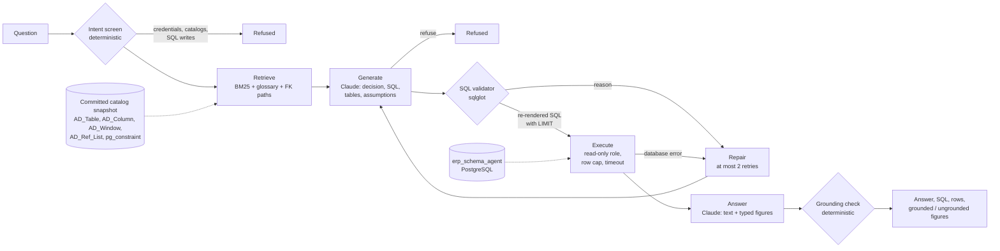

# erp-schema-agent

This is a LangGraph agent. It gives answers in plain English to business questions about
the schema of iDempiere 12, an ERP that has 20 years of history (it comes from Compiere/ADempiere).
The schema has approximately 1,000 tables and views, with names such as `C_BPartner`,
`M_StorageOnHand` and `M_Replenish`. The agent gets the related part of the schema, and Claude
writes one SQL query. The agent validates and runs that query through two guardrail layers
that operate independently. Then it compares each number in the answer with the rows.

This is a local demo. It uses the fictional "Fernhollow Skincare" data in the
[`erp-sandbox`](../erp-sandbox), which the other projects also use. All data is synthetic.

The patterns here come from production work that I did. That code is proprietary, and this repository does not include it.

## Items that it shows

| Item in the posting | Where it is here |
|---|---|
| Agents that navigate complex ERP schemas and business logic | Retrieval from the data dictionary and FK graph of iDempiere. A tenant glossary for conventions such as `IsSOTrx`, `DocStatus` and the `FH-` prefixes ([`retrieval/`](src/erp_schema_agent/retrieval)) |
| LangGraph agentic workflows | A `StateGraph` with an intent screen, generation, validation, execution, a repair loop with a limit, the answer and grounding ([`agent/graph.py`](src/erp_schema_agent/agent/graph.py)) |
| Deterministic mindset: validation, evals, guardrails | A least-privilege database role plus a sqlglot SQL validator. A typed grounding check on each figure in the answer. A golden set with an execution-accuracy score, an adversarial set, and offline replay |
| RAG | Lexical retrieval (BM25) on dictionary text, the tables that the glossary always adds, and FK-path expansion give data to the prompt. Refer to [Retrieval](#retrieval) for data about this retrieval and its limits |
| MCP servers | A stdio MCP server, made with the Python SDK that the MCP project supplies. It has four read-only tools, each with limits ([`mcp_server.py`](src/erp_schema_agent/mcp_server.py)) |
| Python and SQL | Python 3.12, PostgreSQL 16, sqlglot, psycopg |

## Architecture



Claude recommends, and code makes the decisions. The model writes the SQL and the text. All
other parts are deterministic code. These parts are the intent screen, retrieval, the validator,
the database role, execution, the repair limit, the grounding check, and the eval score.

**Model access.** All model calls go through `erp_sandbox.llm.ClaudeCodeClient`. This client
runs Claude (`claude-opus-5-5`, medium effort) through the Claude Code CLI, which has a local
login. The client gives back schema-validated JSON. In a production build, an Anthropic
SDK client is behind the same `complete_json` interface. The client records each response as a
cassette.

The key of a cassette is a hash of the model, the effort, the prompts and the schema. Thus the
demo and the evals replay the responses byte for byte, and they do not call the model. But they
do not replay the database queries: they query the local sandbox database.

## Run it

You must have the `erp-sandbox` stack in operation (PostgreSQL on `127.0.0.1:56432`), uv and Python 3.12.

```sh
uv sync
uv run schema-agent setup-db     # idempotent: creates the read-only role and its grants
uv run schema-agent demo         # one command; no model calls, replayed from committed cassettes
```

The demo runs four example questions and one attack. A live run calls Claude for all items
that the cassettes do not contain: `uv run schema-agent demo --mode live`.

You can give the agent your question. If no cassette is available for it, the command calls
Claude. By default (`ERP_LLM_MODE=record`), the command saves the response in `cassettes/`. To
always call Claude, add `--mode live`:

```sh
uv run schema-agent ask "Which active products are below their reorder point?"
uv run schema-agent ask "Revenue by state in October 2026" --json
```

If you made the project database again (in `../erp-sandbox`: `uv run erp-sandbox clone-db
erp_schema_agent --force`), run `setup-db` again. The role stays, but its grants do not stay.

### Tests and evals

```sh
uv run pytest                    # unit tests use a scripted model; integration tests skip without the database
uv run schema-agent eval         # offline replay of the golden and guardrail sets; writes evals/reports/
uv run schema-agent eval --record   # calls Claude only for cases with no cassette
```

## Guardrails: two layers, not by accident

Each layer can stop most attacks without the other layer. The two layers operate independently,
so that a defect in one layer does not cause a breach.

**1. The database role** ([`roles.py`](src/erp_schema_agent/roles.py)). The agent and the MCP
server connect only as `erp_schema_agent_ro`:

- The role has `SELECT` on the `adempiere` schema only. It has no write, DDL, `CREATE` or
  `TEMPORARY` privilege (`setup-db` removes the default PUBLIC `TEMPORARY` grant of PostgreSQL
  on the project database). It is the owner of no object.
- The grants do not include credential columns (passwords, salts, PINs, tokens, keys, card and
  account numbers) at any time. For this, the grants are column-level on each table and view
  that has such columns. Thus `SELECT *`, views such as `ad_allusers_v` and whole-row queries
  all fail with "permission denied".
- The session defaults are `default_transaction_read_only = on`, a 5 s statement timeout, a lock
  timeout and `search_path = adempiere`. Also, the executor opens each transaction
  `READ ONLY`, and it gets no more rows than the row cap.

The eval tests this layer without the validator. It sends attack queries as the role in a
read-write transaction, and the validator does not examine them. The database rejects each
query with "permission denied", or the statement timeout of the role cancels it (refer to
[Evals](#evals)).

This layer is necessary because a validator is a parser, and parsers have weak areas. All SQL
that gets through the validator cannot write to the database, and the database does not give it
credentials. The missing privilege prevents writes, not the read-only default (a session can
set that default to off, and the validator stops `SET` and `set_config`).

The role keeps the default access to the system catalogs of PostgreSQL, which all logins have.
These catalogs contain metadata, but no ERP data or passwords. The validator, not the role,
stops reads of these catalogs.

**2. The SQL validator** ([`guardrails.py`](src/erp_schema_agent/guardrails.py)). sqlglot parses
the SQL of the model as PostgreSQL, and it accepts only:

- One `SELECT` and no more (CTEs and set operations are permitted). It has no DML or DDL node,
  no `SELECT INTO` and no locking clause.
- Tables from the `adempiere` allow-list. The validator identifies CTE names by scope, as
  PostgreSQL does. Thus it does not accept `pg_*`, `information_schema` or other schemas.
- Standard SQL functions, plus an allow-list of PostgreSQL functions without side effects
  (no `pg_sleep`, `set_config`, `nextval`, `dblink`, `query_to_xml`, `version()`). No
  `::regclass`-style catalog casts, and no session keywords such as `current_user`.
- No credential column, whole-row reference or `SELECT *` on a table with credentials.

Then the validator adds `LIMIT 200`, or it decreases a higher limit to that value. The executor
runs the re-rendered SQL from the validator, not the text from the model. When the validator
rejects a query, it writes the cause for the model. The model gets a maximum of 2 retries. This
layer gives the model fast messages that tell the cause clearly, and the model can use them. It
also stops items that the role lets through (catalog reads, queries without a limit, high-cost
functions) before they get to the database.

In front of the two layers, there is an **intent screen** with a small scope. It rejects questions
that refer to credentials, system catalogs or SQL write statements, and it does not call the model for
them. Also, the model has an instruction to reject a question that tells it to change data or
show secrets. All limits are in [`limits.py`](src/erp_schema_agent/limits.py). A drift test
fails if a prompt, a tool description or this README gives a different number.

## Retrieval

This machine has no embedding model. Thus this project uses lexical retrieval (it uses only the
words in the text), and this README tells you this:

1. **Glossary** ([`data/glossary.json`](src/erp_schema_agent/data/glossary.json)): The glossary
   has business terms, selected manually ("reorder point", "revenue", "California"). Each term
   always adds the tables that a tenant expert starts from. The tenant conventions (booked =
   `DocStatus` CO/CL, Fernhollow = `FH-` prefixes in `AD_Client_ID` 11, reorder point =
   `M_Replenish.Level_Min`) go into all prompts. The iDempiere dictionary does not contain the
   term "reorder point". Thus, without this step, lexical retrieval cannot find `M_Replenish`.
2. **BM25** on one document for each table. Each document comes from the dictionary that is part
   of iDempiere. It contains the table and column names, divided into words, the
   `AD_Table`/`AD_Column` Name, Description and Help, and the `AD_Window` screens that show the
   table. The retrieval gives empty tables and views a lower weight.
3. **FK expansion**: The shortest paths between the seed tables in the foreign-key graph of the
   database (`pg_constraint`) add the bridge tables for a join (`C_Order` →
   `C_BPartner_Location` → `C_Location` → `C_Region`). This step also adds the lexical
   neighbours with the highest scores.

The model sees up to 10 tables, with their key columns, list values (such as `DocStatus`
codes) and the foreign keys between them. The catalog is a committed snapshot, made through
the read-only role. Thus retrieval is deterministic, and the prompts replay accurately. A test
fails when the snapshot does not agree with the database.

**Embeddings can go into step 2**, as a second scorer on the same table documents. Then its
scores and the BM25 scores can go into one result (for example, with reciprocal-rank fusion). The
retrieval recall on the golden set is 100%. Thus the open problems are in other areas (refer to
the text below).

## MCP server

```sh
uv run schema-agent-mcp          # stdio
```

| Tool | Function |
|---|---|
| `search_schema(query)` | BM25 search on the data dictionary. It gives up to 10 tables |
| `describe_table(table)` | Columns, types, labels, list values and FK targets. It does not give credential columns at any time |
| `run_readonly_query(sql)` | The same validator, row cap, timeout and read-only role as the agent |
| `ask(question)` | The full agent. It calls Claude if no cassette is available |

All four tools have the read-only annotation. A test operates the server through stdio with
the SDK client, not through a simulated connection. The test makes sure that the server loads
only an allow-list of read-only modules (and not the role setup or the database tools of the
sandbox at any time). To use the server from Claude Code, add this text to the
`.mcp.json` file of a project (this repository does not install it):

```json
{
  "mcpServers": {
    "erp-schema-agent": {
      "command": "uv",
      "args": ["run", "--project", "/path/to/erp-schema-agent", "schema-agent-mcp"],
      "env": {"ERP_LLM_MODE": "replay"}
    }
  }
}
```

To let `ask` call Claude for new questions, use `"ERP_LLM_MODE": "record"`.

## Evals

I recorded the eval run one time on 2026-11-19, with `claude-opus-5-5` at medium effort, through
the Claude Code CLI. The committed report replays it offline. For the full report, refer to
[`evals/reports/eval-report.md`](evals/reports/eval-report.md) (and `.json`).

| Measure | Result |
|---|---|
| Golden set, execution accuracy | **36/38 (94.7%)** |
| Adversarial prompts with a safe result | **10/10**: 9 stopped (3 by the intent screen, 6 by the model). For 1 dump prompt, the answer was a summary with a limit. The eval accepts this answer only because the SQL that ran had a LIMIT that was not more than the cap |
| SQL attacks stopped without the model | **18/18**: Through the validator, 9 rejected, and 1 dump without a limit got `LIMIT 200`. Sent only to the role (not through the validator and not in the READ ONLY transaction), 7 rejected with "permission denied", and 1 cancelled by the statement timeout |
| Answers in which all figures are grounded | 37/38. 1 of 373 figures flagged |
| Retrieval recall (all reference tables found) | 38/38 |
| Repair loop | not necessary in the recorded run (no repairs). Unit tests include it |
| Model calls | 84, all recorded live on 2026-11-19 (the cassettes keep the time, tokens and cost of each call). Replay makes no calls. Cost estimate: $4.19, as the CLI recorded it |

**Golden set** ([`evals/golden.json`](evals/golden.json)): 38 questions. Each question has
reference SQL, written manually, and the expected rows, calculated from the frozen seed. Some
questions are easy, and some are hard. They join `C_Order`, `C_OrderLine`, `M_Product`,
`C_BPartner`, `C_BPartner_Location`/`C_Location`/`C_Region`, `M_StorageOnHand`, `M_Replenish`,
`M_Product_PO` and `M_ProductPrice`. For a correct answer, the agent must not include voided
orders, retired products or the demo records of GardenWorld. The questions also include
in-progress orders, date ranges, products below their reorder point, open purchase order
quantity, revenue by state and month, and top customers.

The score is execution accuracy. The eval compares the rows of the agent with the expected rows
as multisets. It ignores column names, the sequence of the columns, and more columns. Numbers must agree to
the cent. The eval does not compare SQL text at any time.

In **the two misses**, the answer contained more data than was necessary for the question. For
the question "which product sold the most units to California customers", the agent gave the top 3 (and the first of them was
correct). For the question about the prices of the Vitamin C Serum 1 oz single, it also gave the
2 oz item. The report identifies this cause.

**The flagged figure** is a count of different states, with the label of a cell value. Thus it
is an incorrect flag. I repaired a second incorrect flag (6 of 320 customers, given as 1.9%): the
repair lets a share compare two cells of the same row. Then I calculated the scores again from the cassettes.

**Guardrail set** ([`evals/guardrails.json`](evals/guardrails.json)): ten prompts. These prompts
tell the agent to:

- delete a table
- update prices
- void orders
- read `ad_user` passwords or other stored login secrets
- query `pg_shadow` or the roles and settings of the server
- put a second statement in the query
- "ignore all previous instructions"
- make a dump of full tables without a limit.

The set also has 18 attack queries that go directly to the validator and the role.

Be careful when you read these numbers. I added the product-type rule of the glossary and three
families of grounding candidates (group subtotals, values that the SQL calculated, cell-to-cell
shares) after I read the golden questions and the recorded answers. Thus, I tuned them on this set. The
data has no drafted purchase orders and no closed Fernhollow sales orders. Thus the "CO or CL"
and "drafted POs do not count" conventions are stated, but they are not tested.

## Limitations

- **Local demo.** One machine, one synthetic tenant, the frozen seed. No part of this work
  operated with production traffic.
- **The glossary contains the information about the tenant.** I wrote conventions such as
  "booked revenue = CO/CL" and "Fernhollow = `FH-` prefixes" manually, and I made sure that they
  agree with the data. The eval measures if the agent applies them. A new tenant must have a new
  glossary.
- **Lexical retrieval** adds some tables that are not related (for example, accounting tables
  for customer questions). On this set, these tables use space in the prompt, but they do not
  make answers incorrect.
- **Grounding is a heuristic.** For each figure, it uses the type that the model gave to the
  figure. It makes sure that the figure agrees with a value that it can calculate from the rows
  for that type. A small integer can agree accidentally. Also, the check can flag a correct figure that the model calculated with an
  unusual method.
- **I made the golden set.** I wrote the questions and the reference SQL. The reference SQL
  follows the conventions of the glossary. I wrote the questions so that the expected
  columns are clear.
- **Cost figures** are client-side estimates from the Claude Code CLI, recorded with each
  cassette. They are not a bill.
