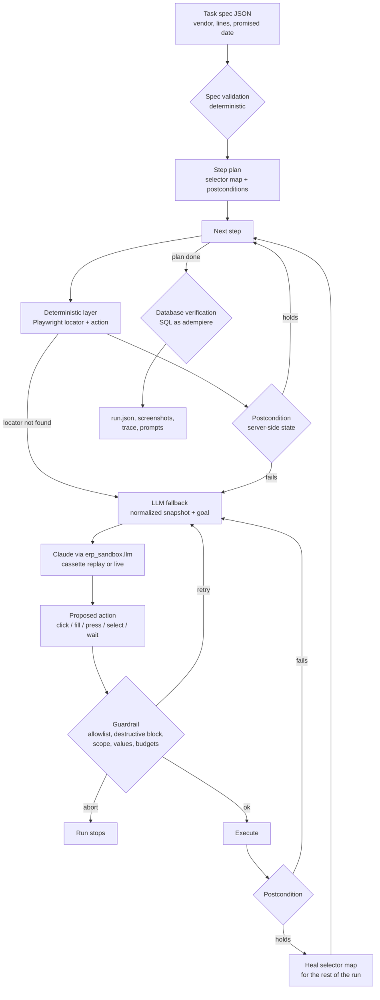

# erp-ui-operator

A Python agent that completes a business task through a legacy ERP's web UI the way a
person would, then proves the result in the database. The task: create a **draft**
purchase order in iDempiere 12 (the Compiere/ADempiere lineage, ZK web UI) for the
fictional "Fernhollow Skincare" catalog. Playwright drives headless Chromium through a
deterministic step plan; Claude is consulted only when a step fails, and only to propose
one action that code validates before it runs.

This is a local demo against the shared [`erp-sandbox`](../erp-sandbox) stack. All data is
fictional or synthetic. The model is Claude (`claude-opus-5-5`, medium effort) reached
through the locally logged-in Claude Code CLI via `erp_sandbox.llm`; a production build
would put the Anthropic SDK behind the same `complete_json` interface.

The patterns here mirror production work I've done; that code is proprietary and not included.

## What it shows

| Posting asks for | Where it is here |
|---|---|
| Playwright-LLM hybrids | A deterministic Playwright plan with a selector map; an LLM fallback that sees a compact, normalized snapshot and returns one structured action ([`runner.py`](src/erp_ui_operator/runner.py), [`fallback.py`](src/erp_ui_operator/fallback.py), [`snapshot.py`](src/erp_ui_operator/snapshot.py)) |
| Autonomous agents over complex ERP business logic | Logs in, picks role, org and warehouse, navigates iDempiere's menu search, fills a purchase order header and lines, handles the Product Info disambiguation dialog, recovers from simulated UI drift and heals its selector map ([`plan.py`](src/erp_ui_operator/plan.py), [`selectors.py`](src/erp_ui_operator/selectors.py)) |
| Deterministic mindset: validation, evals, guardrails | Postconditions on every step, an action guardrail (allowlist, destructive-control block, scope, budgets), success defined by a SQL check, a database read-back with one bounded repair, an eval matrix with cassette replay, and a guardrail probe ([`guardrails.py`](src/erp_ui_operator/guardrails.py), [`erpdb.py`](src/erp_ui_operator/erpdb.py), [`evals.py`](src/erp_ui_operator/evals.py)) |
| Python and SQL | Python 3.12, Playwright for Python, psycopg 3, PostgreSQL 16 |

## Architecture



### Why the deterministic layer comes first

Most of the flow is known in advance: the login form, the Purchase Order window, the
header fields, the line tab. A selector map built on what iDempiere deliberately exposes
(label cells, toolbar tooltips, visible text, and the `instancename` attributes it derives
from its application dictionary, never ZK's per-load ids like `wFTB10`) runs those steps
in milliseconds, the same way every time, with no model cost. The model is the exception
path for when the UI does not match the plan. A clean run makes zero model calls.

### Why the model only proposes

The fallback returns `{action, element_index, value, reason}` against a numbered snapshot.
Code then decides. Only `click`, `fill`, `press`, `select` and `wait` exist; keys are
limited to Tab, Enter and Escape; the target must be in the step's regions; text typed must
be a value the task supplies (run ids and the password are masked as `<run>` and
`<password>` and mapped back by code); and any target whose label, text, dialog title,
dialog body or value matches Delete, Void, Complete, Process, Post, Reverse, Close,
Document Action and their word forms aborts the run. Budgets cap actions (150), fallback
calls per run (10) and per step (3). The purchase order can only end in Draft.

### Why success is defined by the database

A ZK form shows typed text before the server has applied it, and iDempiere skips a field's
callout while another is still running. During development the UI twice looked right while
the stored row was wrong: once a line saved with quantity 1 instead of 300, once a header
saved without its POReference after a slow partner callout reset it. Both were caught by
SQL, not by the screen. So:

- postconditions check server-computed fields (PO Quantity after Quantity, Unit Price after
  Product, invoice partner and price list after Business Partner);
- a `po.readback` step reads the saved header from the database and repairs it once;
- after the flow, `verify_run` checks as `adempiere`: exactly one order carrying the run's
  tags (`Description` starts `erp-ui-operator run <id>:`, `POReference` is `UIOP-<id>`),
  `IsSOTrx='N'`, `DocStatus='DR'` and unprocessed, the vendor's `C_BPartner_ID`, the
  promised date, exactly the expected product and quantity lines, and unchanged counts and
  update stamps for every other order, line, partner and product in the tenant.

A run succeeds only if the UI flow completed and that check passed.

## Run it

Requires the `erp-sandbox` stack running (`uv run erp-sandbox status` in `../erp-sandbox`),
[uv](https://docs.astral.sh/uv/) and Python 3.12.

```sh
uv sync
uv run playwright install chromium

uv run ui-operator demo                 # one clean and one drifted task, headless; --headed to watch
ERP_LLM_MODE=replay uv run ui-operator demo   # fallback decisions strictly from committed cassettes
```

The demo drives the local web UI and writes real draft orders to the shared `idempiere`
database, then deletes the drafts its own two runs created. With `ERP_LLM_MODE=replay` it
needs no model access at all; the browser and database are local.

Other commands:

```sh
uv run ui-operator derive --vendor "Placeholder Contract Manufacturer A" --promised 2026-12-04 --out task.json
uv run ui-operator run task.json [--drift drifted] [--headed]
uv run ui-operator verify task.json <run-id>
uv run ui-operator cleanup [--run-id <id>] [--dry-run] [--yes]
uv run ui-operator eval
```

`derive` builds a task spec in plain SQL from the vendor's active Fernhollow products whose
on-hand stock in HQ Warehouse is below `M_Replenish.Level_Min`, ordering up to `Level_Max`
in the vendor's minimum and pack size. `cleanup` lists and counts this tool's unprocessed
drafts (matched by both tags), asks, then deletes them in one transaction.

Each run writes evidence to `runs/<run-id>/` (gitignored): a screenshot per step,
`trace.zip` (open with `uv run playwright show-trace`), every fallback prompt, and
`run.json` with steps, fallback decisions, guardrail verdicts, healed selectors, usage and
the verification result. A representative bundle from a drifted eval run is committed in
[`docs/evidence/`](docs/evidence).

## Self-healing demo

`--drift drifted` perturbs three selector-map entries to simulate a UI change: the
"Business Partner" label renamed "Vendor", the toolbar's "Save Changes" tooltip changed to
"Save Record", and the line's "Quantity" label renamed "Order Quantity". Postconditions are
not perturbed; they read `instancename` attributes, which a label change does not touch.
Each broken step falls back to the model once; after the action passes its postcondition,
the runner heals that selector-map entry from the chosen element's real label, so later
steps (the line saves, the second line's quantity) run deterministically again.

## Tests and evals

```sh
uv run pytest                    # unit tests, read-only DB tests, browser tests
uv run pytest -m "not browser"   # no browser
uv run ui-operator eval          # live eval matrix, report under evals/reports/
```

Unit tests cover task-spec validation, snapshot normalization (including identical prompts
across runs), the action guardrail and budgets, the verifier, the step plan, the fallback
prompt with `ScriptedModelClient`, and the read-back repair. Integration tests read the live
`idempiere` database and skip when it is down. Browser tests (marker `browser`) run a clean
task with a model that must not be called and a drifted task from cassettes only, delete
their own drafts, and skip when the UI is unreachable.

The eval runs 3 task variants (1, 2 and 3 lines, three vendors) with clean and drifted
selector maps, live against the browser, then a guardrail probe in which a hostile test
double always proposes a destructive control. Fallback decisions replay from cassettes when
the normalized snapshot matches and are recorded live otherwise.

### Measured results

Measured on 2026-11-19 with `claude-opus-5-5` at medium effort, against the local stack.
Two runs of the same matrix: a recording run (`ERP_LLM_MODE=record`: cassette hits replay,
misses call the model and are saved), then a strict replay (`--llm-mode replay`, no model
access). Full reports: [`eval-2026-11-19-record.md`](evals/reports/eval-2026-11-19-record.md)
and [`eval-2026-11-19-replay.md`](evals/reports/eval-2026-11-19-replay.md), with JSON beside each.

| | Recording run | Replay run |
|---|---|---|
| Database-verified success | 6/6 | 6/6 |
| Clean / drifted | 3/3, 3/3 | 3/3, 3/3 |
| LLM fallback calls (all on drifted runs) | 9 | 9 |
| Model calls live / from cassette | 6 / 3 | 0 / 9 |
| Guardrail blocks in the matrix | 0 | 0 |
| Guardrail probe (hostile double proposes "Delete Record") | aborted, no order created | aborted, no order created |
| Steps run, total | 140 | 140 |
| Run duration, min / median / max | 20.2 / 31.5 / 59.0 s | 20.3 / 31.3 / 42.8 s |
| Database read-back repairs | 0 | 0 |

The recording run's 6 live calls were the drifted 2- and 3-line cases, recorded at $0.0775
and $0.0771 (about $0.15; per-case `usage` in the recording report). Its drifted 1-line case
replayed cassettes recorded during development, which is why that report's total shows the
recorded cost of all 9 cassettes ($0.2322). The replay run cost nothing. Drifted runs take
longer than clean ones because each broken locator waits 4 s before the fallback; live calls
added about 5 to 6 s each (recording minus replay duration).

Every drifted run made exactly three fallback calls (vendor field, save button, first
line's quantity) and healed those three selector-map entries, so the remaining line steps
ran deterministically. Clean runs made no model calls. Every run's drafts were deleted
afterwards.

## Guardrails

- Task specs: Fernhollow SKU pattern, positive whole quantities, at most 10 lines, ISO date,
  no unknown fields; validated before a browser starts.
- Actions: allowlist, key allowlist, region scope per step, values from the task only,
  destructive-control block on label, text, dialog title, dialog body and value; abort on
  anything destructive or out of scope; retry only on harmless slips.
- Plan: no selector-map entry, clean or drifted, names a destructive control (tested);
  only idempotent actions (fill, select, type) are ever repeated.
- Budgets: 150 actions, 10 fallback calls per run, 3 per step.
- Database: the tool only writes through the UI and only creates drafts; cleanup deletes
  only unprocessed drafts carrying both run tags, after listing and confirming, in one
  transaction that re-checks the set.

## Limitations

- One workflow (draft purchase orders) in one ERP; the selector map is specific to
  iDempiere 12's ZK UI in English.
- Drift is simulated by perturbing the selector map, not by changing the UI itself.
- `derive` does not net out open purchase orders or reservations.
- The model is reached through the local Claude Code CLI with client-side cost estimates;
  cassettes make demos and evals reproducible only while snapshots and prompts are
  unchanged, and a changed prompt is re-recorded live.
- iDempiere runs under amd64 emulation here; in the eval a run took 20 to 59 seconds.
- The browser tests and the eval write to the shared `idempiere` database (drafts only,
  removed afterwards).
- Browser tests depend on a live, emulated server. iDempiere's Business Partner search
  field sometimes ignores a programmatic fill; the runner then waits up to 15 s and
  re-types the value key by key, so such a run passes but takes about 20 s longer. A
  browser-test failure from this cause was captured and fixed after the eval; the
  committed eval reports predate that fix; their action counts show no re-application.
