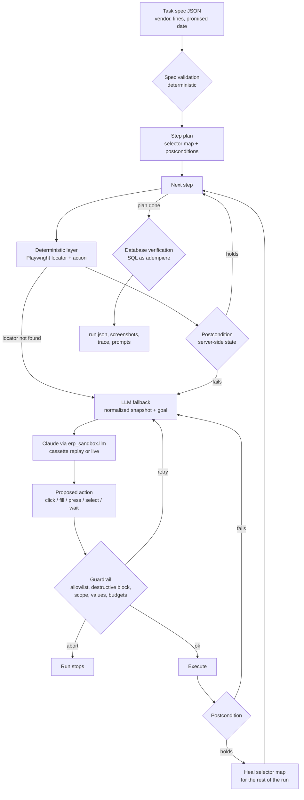

# erp-ui-operator

This Python agent completes a business task through the web UI of a legacy ERP, as a
person does. Then it uses the database to show that the result is correct. The task is to
make a **draft** purchase order in iDempiere 12 (the Compiere/ADempiere lineage, ZK web UI)
for the catalog of "Fernhollow Skincare", a fictional brand. Playwright controls headless
Chromium through a deterministic plan of steps. The agent calls Claude only when a step does
not complete correctly. Claude only recommends one action, and code validates that action
before the action runs.

This agent is a local demo that uses the shared [`erp-sandbox`](../erp-sandbox) stack. All
data is fictional data or synthetic data. The model is Claude (`claude-opus-5-5`, effort
"medium"). The agent gets access to Claude through `erp_sandbox.llm` and the Claude Code CLI,
which has a local login. In a production build, the Anthropic SDK is behind the same
`complete_json` interface.

The patterns here come from production work that I did. That code is proprietary, and this
repository does not include it.

## Items that it shows

| Item in the posting | Location here |
|---|---|
| "Playwright-LLM hybrids" | A deterministic Playwright plan that has a selector map. An LLM fallback that gets a small, normalized snapshot and gives one action as a JSON object ([`runner.py`](src/erp_ui_operator/runner.py), [`fallback.py`](src/erp_ui_operator/fallback.py), [`snapshot.py`](src/erp_ui_operator/snapshot.py)) |
| "Autonomous agents over complex ERP business logic" | The agent completes the login and selects the role, organization and warehouse. It navigates the menu search of iDempiere and fills the header and lines of a purchase order. It uses the Product Info dialog to select the correct product. It continues after simulated UI drift, and it updates its selector map ([`plan.py`](src/erp_ui_operator/plan.py), [`selectors.py`](src/erp_ui_operator/selectors.py)) |
| "Deterministic mindset: validation, evals, guardrails" | A postcondition on each step. An action guardrail (allowlist, a stop for destructive controls, scope, limits). A SQL check that shows if a run is satisfactory. A database read-back with a maximum of one repair. An eval matrix with cassette replay. A guardrail probe ([`guardrails.py`](src/erp_ui_operator/guardrails.py), [`erpdb.py`](src/erp_ui_operator/erpdb.py), [`evals.py`](src/erp_ui_operator/evals.py)) |
| "Python and SQL" | Python 3.12, Playwright for Python, psycopg 3, PostgreSQL 16 |

## Architecture



### Decision: the deterministic layer comes first

You know most of the flow before the run starts: the login screen, the Purchase Order
window, the header fields and the line tab. The selector map uses only the stable items that
iDempiere makes available to the UI. These items are label cells, toolbar tooltips, text
that you can see, and the `instancename` attributes. iDempiere makes these attributes from
its application dictionary. The selector map does not use ZK IDs that change at each page
load, for example `wFTB10`, at any time. Thus, the selector map runs those steps in
milliseconds, with the same result each time, and with no model cost.

The agent uses the model only for the condition when the UI does not agree with the plan. A
clean run makes no calls to the model.

### Decision: the model only recommends

The fallback gives `{action, element_index, value, reason}` for a snapshot in which each
element has a number. Then code makes the decision. The only actions are `click`, `fill`,
`press`, `select` and `wait`. The agent can use only the Tab, Enter and Escape keys. The
element for the action must be in the areas of the step. Text that the agent types must be a
value from the task.

Code shows run IDs and the password to the model only as `<run>` and `<password>`. Then code
changes them back to the initial values. The guardrail has a list of words: Delete, Void,
Complete, Process, Post, Reverse, Close, Document Action and their word forms. The guardrail
examines the label, text, dialog title, dialog body and value of the element for the action. If
one of them agrees with a word in this list, the guardrail aborts the run.

The limits are a maximum of 150 actions, 10 fallback calls for each run, and 3 fallback calls
for each step. At the end, the purchase order can only be in Draft.

### Decision: the database shows if a run is satisfactory

The ZK UI shows typed text before the server applies it. Also, iDempiere does not do the
callout of a field while a different callout runs.

Two times during the work on this agent, the UI showed correct data, but the row in the
database was incorrect. The first time, the database stored a line with quantity 1, not 300.
The second time, a slow partner callout removed the POReference value, and the header went
into the database without its POReference. In the two problems, SQL found the error, but the
screen did not show it.
Because of this, the agent does these checks:

- Postconditions examine fields that the server calculates (PO Quantity after Quantity, Unit
  Price after Product, invoice partner and price list after Business Partner).
- A `po.readback` step reads the saved header from the database and repairs it one time.
- After the flow, `verify_run` does a check as `adempiere`. There must be one order, and only
  one, that has the tags of the run (`Description` starts `erp-ui-operator run <id>:`,
  `POReference` is `UIOP-<id>`). That order must have `IsSOTrx='N'` and `DocStatus='DR'`, and
  it must be unprocessed. It must have the `C_BPartner_ID` of the vendor and the promised date.
  Its lines must be the specified product and quantity lines, with no other lines. For all
  other orders, lines, partners and products in the tenant, the counts and update timestamps
  must not change.

A run is satisfactory only if the UI flow completed and that check passed.

## Run it

Before you start, make sure that the `erp-sandbox` stack runs
(`uv run erp-sandbox status` in `../erp-sandbox`). You must also have [uv](https://docs.astral.sh/uv/) and Python 3.12.

```sh
uv sync
uv run playwright install chromium

uv run ui-operator demo                 # one clean and one drifted task, headless; --headed to watch
ERP_LLM_MODE=replay uv run ui-operator demo   # fallback decisions strictly from committed cassettes
```

The demo controls the local web UI and writes draft orders into the shared `idempiere`
database. These draft orders are not simulated. Then the demo deletes the drafts that its two
runs made. With `ERP_LLM_MODE=replay`, access to the model is not necessary at any time. The
browser and the database are local.

Other commands:

```sh
uv run ui-operator derive --vendor "Placeholder Contract Manufacturer A" --promised 2026-12-04 --out task.json
uv run ui-operator run task.json [--drift drifted] [--headed]
uv run ui-operator verify task.json <run-id>
uv run ui-operator cleanup [--run-id <id>] [--dry-run] [--yes]
uv run ui-operator eval
```

`derive` uses only SQL to make a task spec. It uses the active Fernhollow products of the
vendor that have on-hand stock in HQ Warehouse below `M_Replenish.Level_Min`. For each
product, the order quantity increases the stock to a maximum of `Level_Max`. The quantity
also agrees with the minimum quantity and pack quantity of the vendor. `cleanup` shows a list
and a count of the unprocessed drafts of this tool (drafts that have the two tags). It waits
for your approval, and then it deletes them in one transaction.

Each run writes evidence to `runs/<run-id>/` (Git ignores this directory). The evidence
contains a screenshot for each step, `trace.zip` (open it with `uv run playwright show-trace`),
all fallback prompts, and `run.json`. This file contains the steps, fallback decisions,
guardrail decisions, updated selectors, model use and the result of the database check. The
repository contains a typical evidence set from a drift eval run in
[`docs/evidence/`](docs/evidence).

## Self-healing demo

`--drift drifted` changes three entries in the selector map to simulate a UI change. The
"Business Partner" label changes to "Vendor". The "Save Changes" tooltip of the toolbar
changes to "Save Record". The "Quantity" label of the line changes to "Order Quantity". The
postconditions do not change. They read `instancename` attributes, and a label change does
not change these attributes.

Each defective step calls the model one time through the fallback. After the action passes
its postcondition, the runner updates that selector-map entry from the label that the selected
element has in the UI. Thus, subsequent steps (the saves of the lines, the quantity of the
second line) run through the deterministic layer again.

## Tests and evals

```sh
uv run pytest                    # unit tests, read-only DB tests, browser tests
uv run pytest -m "not browser"   # no browser
uv run ui-operator eval          # live eval matrix, report under evals/reports/
```

Unit tests include task-spec validation and snapshot normalization (with a check that runs
give the same prompts). They also include the action guardrail and limits, the verifier, the
step plan, the fallback prompt with `ScriptedModelClient`, and the read-back repair.

Integration tests read the live `idempiere` database. If the database is not available,
pytest does not run these tests. Browser tests (marker `browser`) run a clean task with a model
that the test must not call. They also run a drift task that uses only cassettes. The browser
tests delete the drafts that they made. If the UI is not available, pytest does not run these tests.

The eval runs 3 task variants (1, 2 and 3 lines, three vendors) with clean selector maps and
with drift selector maps. These runs use the live browser. Then the eval runs a guardrail
probe. In this probe, a hostile test double always recommends a destructive control. If the
normalized snapshot agrees with a cassette, the fallback decision comes from that cassette. If
not, the eval calls the live model and records the decision.

### Measured results

These results are from 2026-11-19, with `claude-opus-5-5` at effort "medium" and the local
stack. The eval ran the same matrix two times. The first run was a record-mode run
(`ERP_LLM_MODE=record`). In this run, if a cassette agrees with the snapshot, the run replays
that cassette. If no cassette agrees, the run calls the model and saves the result as a
cassette. The second run was a strict replay
(`--llm-mode replay`), with no access to the model.

The full reports are [`eval-2026-11-19-record.md`](evals/reports/eval-2026-11-19-record.md) and
[`eval-2026-11-19-replay.md`](evals/reports/eval-2026-11-19-replay.md). Each report has a JSON
file adjacent to it.

| | Record-mode run | Replay run |
|---|---|---|
| Satisfactory runs (database check) | 6/6 | 6/6 |
| Clean / drift | 3/3, 3/3 | 3/3, 3/3 |
| LLM fallback calls (all on drift runs) | 9 | 9 |
| Model calls live / from cassette | 6 / 3 | 0 / 9 |
| Actions that the guardrail stopped in the matrix | 0 | 0 |
| Guardrail probe (hostile double recommends "Delete Record") | aborted, no order made | aborted, no order made |
| Steps run, total | 140 | 140 |
| Run time, min / median / max | 20.2 / 31.5 / 59.0 s | 20.3 / 31.3 / 42.8 s |
| Database read-back repairs | 0 | 0 |

The 6 live calls of the record-mode run were in the drift 2- and 3-line cases. The recorded
cost of these cases was $0.0775 and $0.0771 (approximately $0.15 in total). The record-mode
report shows the `usage` for each case. The drift 1-line case of the record-mode run replayed
cassettes that development runs recorded. Because of this, the total in that report shows the
recorded cost of all 9 cassettes ($0.2322).

The replay run had no cost. Drift runs use more time than clean runs, because each defective
locator waits 4 s before the fallback. Each live call added approximately 5 to 6 s (record-mode
run time minus replay run time).

Each drift run made three fallback calls, no more and no less (vendor field, save button,
quantity of the first line). Each drift run also updated those three selector-map entries.
Thus, the remaining line steps ran through the deterministic layer. Clean runs made no model
calls. After each run, the eval deleted the drafts of that run.

## Guardrails

- Task specs: Fernhollow SKU pattern, quantities that are positive integers, a maximum of 10
  lines, ISO date, no unknown fields. The agent validates the task spec before a browser starts.
- Actions: allowlist, key allowlist, area scope for each step, and values only from the task.
  The guardrail also has a stop for destructive controls on label, text, dialog title, dialog
  body and value. The guardrail aborts the run if an action uses a destructive control or is
  out of scope. The guardrail lets the model try again only after small errors that cause no damage.
- Plan: no selector-map entry, clean or drift, identifies a destructive control (a test
  examines this). Only idempotent actions (fill, select, type) occur more than one time.
- Limits: 150 actions, 10 fallback calls for each run, 3 for each step.
- Database: the tool writes only through the UI, and it makes only drafts. The cleanup
  command deletes only unprocessed drafts that have the two run tags. Before it deletes them,
  it shows a list and gets your approval. It deletes them in one transaction that does a check
  of the set again.

## Limitations

- One workflow (draft purchase orders) in one ERP. The selector map is only for the ZK UI of
  iDempiere 12 in English.
- This tool simulates drift with changes to the selector map. It does not change the UI.
- `derive` does not subtract open purchase orders or reservations.
- The agent gets access to the model through the local Claude Code CLI, and the cost estimates
  come from the client. With cassettes, demos and evals give the same results again only while
  snapshots and prompts do not change. For a changed prompt, the eval calls the live model and
  records the result again.
- Here, iDempiere runs in amd64 emulation. In the eval, the time for a run was 20 to 59 seconds.
- The browser tests and the eval write to the shared `idempiere` database (only drafts, which
  they remove after the run).
- Browser tests operate correctly only with a live server in emulation. The Business Partner
  search field of iDempiere can ignore a fill from code. If this occurs, the runner waits a
  maximum of 15 s and types the value again, one key at a time. Thus, the browser test passes,
  but the run uses approximately 20 s more time.

  A browser test failed because of this problem. After the eval, the failure was recorded and repaired. The committed eval
  reports are from a time before that repair. Their action counts do not show that the runner
  typed a value again.
